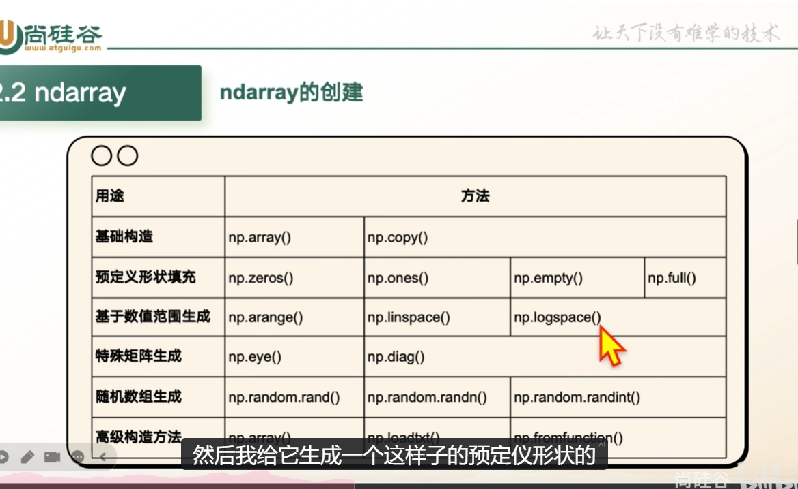
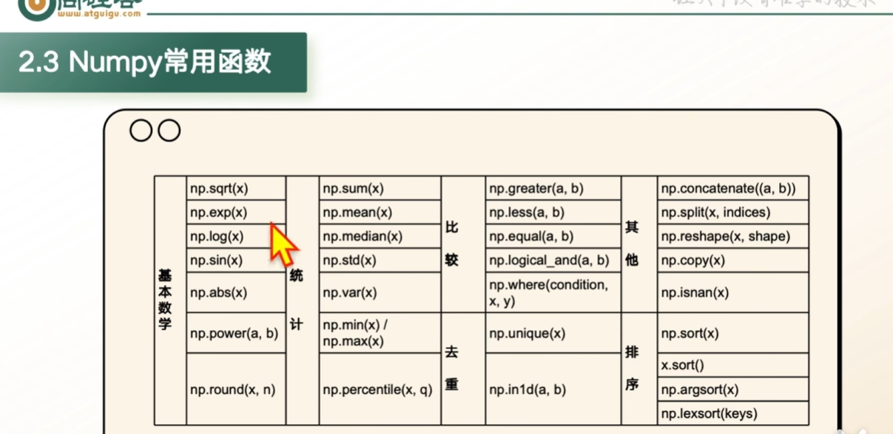

## ndarray属性

1. **shape**: 数组的形状:几行几列 arr.shape
2. **ndim**:维度数量 arr.ndim
3. **size** :总元素个数: arr.size
4. **dtype** :元素类型:arr.dtype
5. **T**转置:arr.T(仅二维数组及以上生效)
6. **itemsize**:单个元素占内存:arr.itemsize
7. **nbytes**:数组总内存占用量:size\*itemsize,arr.nbytes
8. **flags**:内存储存方式:是否可连续化:arr.flags

## ndarray的创建

1. **基础构造**:适用于手动构建小规模数组或复制已有数据,np.array(),np.copy(),**copy是深拷贝,不共用内存地址,直接相等是浅拷贝,会共用内存地址**
2. **预定义形状填充**:用于快速初始化固定形状的数组(如全0占位,全一初始化) np.zeros(),np.ones(),np.empty(),np.full(),np.zreos_like()中为模仿括号数组的形状
3. **特殊矩阵生成**:数学运算专用(如线性代数中的单位矩阵),np.eye,np.diag()
4. **随机数组生成**:模拟实验数据,初始化神经网络权重等场景,np.random.rand(),np.random.randn(),np.random.randint()
5. **高级和构造方式**:处理非结构化数据(如文件,字符串)或通过函数生成复杂数组,np.array,np.loadtxt,np.fromfunction

## ndarray的数据结构

**bool**:布尔类型
**int(8,16,32,64),uint(8,16,32,64)**:有无符号的n位整型
**float(16,32,64)**:半,单,双精度浮点型
**complex(64,128)**:用两个n位浮点数表示的复数

## ndarray的索引与切片

1. **基本索引**:索引从零开始
2. **行/列切片**:使用冒号:切片语法选择行或列的子集
3. **连续切片**:从起始索引到结束索引按步长切片
4. **使用sllce函数**:通过sllce(start,stop,step)定义切片规则
5. **布尔索引**:通过布尔条件筛选满足条件的元素.支持逻辑运算符&|
   
   

## 补充:

1. 矩阵乘法为@,如A@B
2.
